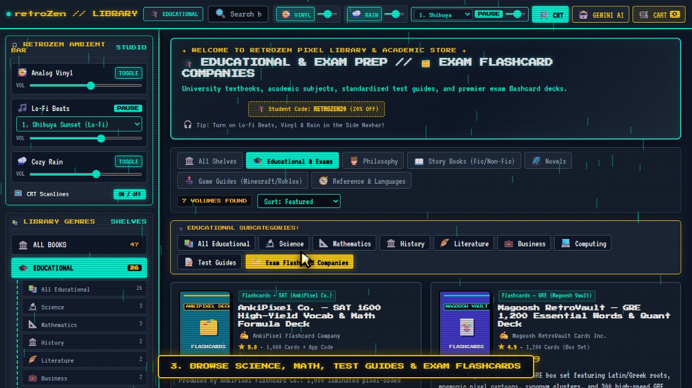
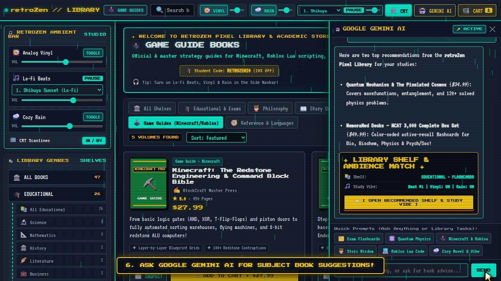

# 📚 Dream Bytes — retroZen Pixel Library Store

**Team Members:** Summaiya, Ramsha, and Bhoomika  
**Live Deployment Link:** [https://retro-pixel-library.vercel.app/](https://retro-pixel-library.vercel.app/)

---

## 🎯 Theme & Problem Statement

**Theme:** Retro Pixelated Educational Library & Lo-Fi Study Sanctuary  

Physically traveling to libraries and searching across endless shelves for textbooks, standardized exam flashcards, or leisure reading is exhausting and time-consuming for students and avid readers. **Dream Bytes** solves this by bringing the entire library experience online in a calming, retro-pixelated store where users can filter by academic subcategories in seconds, study with built-in Vinyl, Rain, and Lo-Fi beats, and ask an integrated **Google Gemini AI Librarian** for instant book recommendations or subject explanations.

---

## 📸 Project Screenshots

### 1. Storefront Overview, Side Navbar Ambient Studio & Exam Subcategories


### 2. Live Google Gemini AI Librarian & One-Click Shelf Recommendations


---

## 🤖 How AI Is Used

- **API & Pre-Trained Models Used:** **Google Gemini API** (`https://generativelanguage.googleapis.com/v1beta/models/...:generateContent`), dynamically routing across Google's pre-trained **`gemini-2.5-flash`**, **`gemma-4-26b-a4b-it`**, and **`gemma-4-31b-it`** models through our secure backend serverless endpoint (`/api/gemini`) powered by the `GEMINI_API_KEY` environment variable.
- **What It Takes as Input:**
  - `prompt`: The user's natural-language question or request (ranging from general knowledge, science, math, and coding questions to requests for specific textbooks, SAT/GRE/MCAT/IGCSE/A-Level/Bar Exam flashcards, or Minecraft/Roblox guides).
  - `history`: An array of prior user and model turns for multi-turn conversational memory.
  - `storeContext`: The user's currently active library shelf, subcategory, and shopping cart item count.
- **What It Returns:**
  - `text`: A rich, Markdown-formatted conversational response that answers the user's question or explains recommended books.
  - `recommendation`: A structured JSON object (`category`, `subcategory`, `keywords`, and `ambientSuggestion` specifying the Lo-Fi beat track, vinyl crackle, and rain settings) that the frontend renders as an interactive **"Open Recommended Shelf & Study Vibe"** card.

---

## 🚀 Steps to Run the Project Locally

1. **Clone the Repository:**
   ```bash
   git clone https://github.com/ramshariaz511-ux/retro-pixel-library.git
   cd retro-pixel-library
   ```

2. **Configure Your Isolated `.env` File:**
   Create a `.env` file in the project root (or copy `.env.example` to `.env`) and add your Google Gemini API key:
   ```env
   GEMINI_API_KEY=your_gemini_api_key_here
   PORT=3005
   ```

3. **Start the Server:**
   *(No external npm packages are required — runs on pure Node.js!)*
   ```bash
   npm start
   ```

4. **Open in Browser:**
   Visit **`http://localhost:3005`** in your browser.

---

## 📦 Datasets, Pre-Trained Models & Resources Used (Credits)

- **Dream Bytes Multi-Genre Book & Standardized Exam Flashcard Catalog Dataset (`js/catalog.js`):**
  - *Authors & Curators:* **Ramsha, Bhoomika, and Summaiya**
  - Custom-authored dataset of 36+ volumes across Educational subcategories (*Science, Mathematics, History, Literature, Business, Computing, Test Guides, and Standardized Exam Flashcard Companies for SAT, GRE, MCAT, IGCSEs, A-Levels, and Bar Exam*), *Philosophy*, *Fictional/Non-Fictional Story Books*, *Novels*, *Minecraft & Roblox Game Guides*, and *Academic Reference*.
- **Procedural Web Audio Synthesizer & Ambient Studio (`js/audio.js`):**
  - *Authors:* **Ramsha, Bhoomika, and Summaiya**
  - 100% procedural Web Audio API engine generating 6 chill Lo-Fi beat tracks, warm analog vinyl crackle, stereo rain ambience, CRT relay clicks, paper page-turns, and arcade coin chimes with zero external audio files.
- **Retro Pixel UI Theme, Procedural SVG Book Covers & Custom Yellow Pixel Cursor (`css/retro.css`, `js/app.js`):**
  - *Authors & Designers:* **Ramsha, Bhoomika, and Summaiya** (inspired by our *retroZen Driving* & *Retro Fidget Haven* design system).
- **Pre-Trained AI Models:**
  - **Google Gemini & Gemma Foundation Models** (`gemini-2.5-flash`, `gemma-4-26b-a4b-it`, `gemma-4-31b-it`) by **Google DeepMind / Google AI Studio**.
- **Typography:**
  - `Press Start 2P` (by CodeMan38) and `VT323` (by Peter Hull) via **Google Fonts**.
